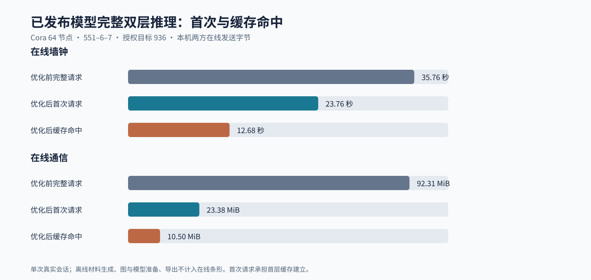

# 已发布模型完整双层推理实测

本页由 `scripts/report_full_inference.py` 从真实验收记录生成；原始记录为 `results/chapter5/full-query-acceptance.json`。
三种条件均使用已验收的 64 节点、160 轮密态训练发布模型，固定授权目标 936；优化前为既有独立验收会话，优化后两次为本轮各自新材料的真实页面 API 请求。

| 条件 | 在线秒 | 双方发送字节 | 轮数 | 离线秒 | 完整请求秒 |
|---|---:|---:|---:|---:|---:|
| 优化前完整请求 | 35.761 | 96,792,628 | 1306 | 50.628 | — |
| 优化后首次请求 | 23.762 | 24,517,054 | 1064 | 26.800 | 53.337 |
| 优化后缓存命中 | 12.684 | 11,012,312 | 812 | 11.857 | 26.377 |

相对既有完整请求，首次在线时延改善 **1.50 倍**、通信缩减 **3.95 倍**；缓存命中分别为 **2.82 倍**、**8.79 倍**。
缓存命中相对本轮首次请求，在线时延改善 **1.87 倍**、通信缩减 **2.23 倍**。首次请求承担首层计算和缓存持久化，第二次仍重新生成一次性离线材料并执行第二层、秘密概率及授权交付。

两次最终七类概率均逐项等于已验收独立定点参考：`[2944,58,20,938,25,67,40]/4096`；会话和材料批次不同，环材料及 HE 掩码标识无交集。完整交付后角色私有首层份额与模型、图、输入哈希和来源会话绑定；第二次操作记录从 `load_hidden` 开始，仍包含第二层 HE 聚合、概率电路和 `deliver`。

## 分阶段在线成本

| 条件 | 阶段序列：阶段类型 / 较慢角色耗时秒 / 双方发送字节 / 轮数 |
|---|---|
| 优化前完整请求 | matmul 1.904s / 16,661,882B / 134轮；he_aggregate 11.627s / 32,185,068B / 159轮；matmul 0.820s / 1,521,590B / 123轮；he_aggregate 12.317s / 37,366,904B / 114轮；precision_up 0.266s / 166,180B / 46轮；probability 4.956s / 8,890,550B / 729轮；deliver 0.001s / 0B / 0轮 |
| 优化后首次请求 | matmul 2.179s / 5,108,186B / 134轮；he_aggregate 7.072s / 8,394,516B / 118轮；matmul 0.701s / 285,564B / 123轮；he_aggregate 6.412s / 9,637,268B / 102轮；precision_up 0.256s / 42,418B / 46轮；probability 2.958s / 1,048,576B / 540轮；deliver 0.001s / 0B / 0轮 |
| 优化后缓存命中 | load_hidden 0.054s / 0B / 0轮；matmul 0.744s / 285,014B / 123轮；he_aggregate 6.871s / 9,637,072B / 102轮；precision_up 0.210s / 42,328B / 46轮；probability 2.957s / 1,047,372B / 540轮；deliver 0.001s / 0B / 0轮 |

阶段墙钟取同时执行的两个在线角色中较慢者，不能相加当作总墙钟；其中 `he_aggregate` 含 HE 聚合、受保护转换、截断和必要激活，内部嵌套组件不能重复相加。各阶段通信之和不含少量握手帧，总通信以上表为准。

## 边界与解释

在线成本与离线成本分别记录；首次请求的预热工作不摊入第二次在线成本。历史基线是同模型同图同目标的真实完整查询，但来自先前冻结版本；这里每个条件只有一次会话，数字不是稳定分布或跨系统成绩。旧版完整服务在线成本的另一次既有查询为 35.780 秒、96,792,628 字节、1306 轮，可交叉核对历史基线。
清理记录分别保存删除文件分配块、末次硬链接分配块、内部可用空间变化和宿主可用空间变化；不会把可回收上界当作宿主实际回收。

| 本轮清理 | 删除文件分配块 | 末次硬链接分配块 | 内部可用空间变化 | 宿主可用空间变化 |
|---|---:|---:|---:|---:|
| 优化后首次请求 | 382,722,048 | 382,509,056 | 382,423,040 | 0 |
| 优化后缓存命中 | 182,018,048 | 181,903,360 | 181,846,016 | 0 |

Panther 官方实现使用四方计算，尚未在相同工作负载、设备及网络下复测。因此 20 倍在线时延和 400 倍在线通信量目标仍为“缺少可比外部基线，无法判断”，不能用本表内部优化倍数替代。
本机六身份隔离只属于部署保障；两方半诚实、可信离线方、管理员边界和 64 节点分层抽样范围保持不变。
